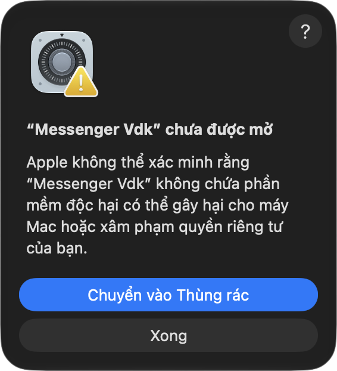
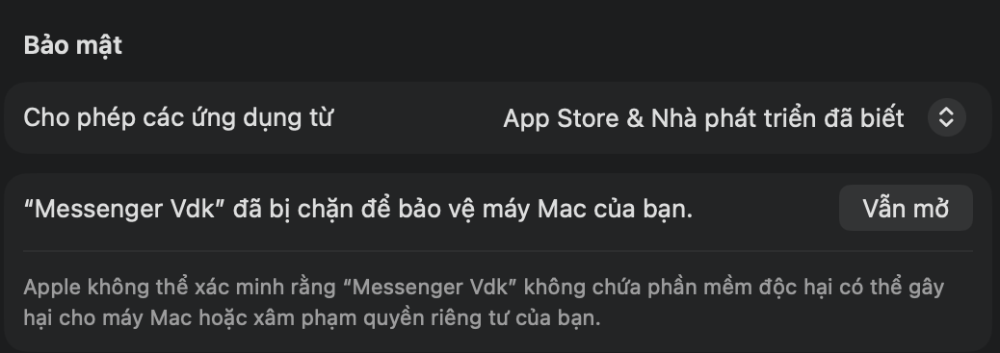

# Hướng dẫn tải và cài Messenger Vdk

## 1. Kiểm tra máy
- **Chip Apple** (M1, M2, M3…) và **macOS 14** trở lên. Xem ở menu **Apple** (logo quả táo góc trên bên trái) → **Giới thiệu về máy Mac**. Máy chip Intel không chạy được.

## 2. Tải
Vào **[Releases](https://github.com/Vduck141/messenger-vdk/releases/latest)** → mục *Assets* → tải file **`Messenger.Vdk.<bản>.dmg`**.

## 3. Cài
Bấm đúp file DMG → cửa sổ hiện ra → **kéo Messenger Vdk vào Applications**. Xong có thể tháo ổ DMG (bấm ⏏ trong Finder).

## 4. Mở lần đầu
App chưa được Apple công chứng (cần gói Apple Developer trả phí), nên lần đầu macOS có thể chặn. Xem máy bạn thuộc trường hợp nào:
**Cài đặt hệ thống → Quyền riêng tư & Bảo mật → mục Bảo mật → «Cho phép các ứng dụng từ»**.

### Trường hợp A – đang chọn «App Store» hoặc «App Store & Nhà phát triển đã biết» (mặc định, đa số máy)
Cả 2 lựa chọn này đều chặn app, làm như sau:
1. Mở **Messenger Vdk** trong Applications → hiện hộp *«"Messenger Vdk" chưa được mở»* → bấm **Xong** (đừng bấm «Chuyển vào Thùng rác»).

   

2. Mở **Cài đặt hệ thống → Quyền riêng tư & Bảo mật** → kéo xuống mục **Bảo mật** → dòng *«"Messenger Vdk" đã bị chặn để bảo vệ máy Mac của bạn.»* → bấm **Vẫn mở** → nhập mật khẩu máy (hoặc Touch ID).

   

3. Mở lại app. Nếu macOS hỏi lại, bấm **Mở** / **Vẫn mở**. Từ lần sau mở bình thường.

> Không thấy nút «Vẫn mở»? Nút chỉ hiện một lúc sau khi app bị chặn – mở app thêm 1 lần rồi vào lại Cài đặt.
> «Chuột phải → Mở» **không còn** tác dụng từ macOS 15.

### Trường hợp B – máy đã tắt Gatekeeper (có thêm lựa chọn thứ ba như «Mọi nơi» và đang chọn nó)
Bấm đúp là mở. Nếu macOS hỏi *«tải về từ Internet, có muốn mở không?»* → bấm **Mở**.
Không cần (và không nên) tắt Gatekeeper chỉ để cài app này – làm theo trường hợp A là đủ.

### Trường hợp C – cách nhanh bằng Terminal (dùng được cho cả A và B)
Mở **Terminal**, dán lệnh rồi Enter, sau đó mở app bình thường:
```bash
xattr -dr com.apple.quarantine "/Applications/Messenger Vdk.app"
```
Lệnh chỉ bỏ dấu «tải từ Internet» của riêng app này, không đổi cài đặt bảo mật của máy.

## 5. Lần đầu dùng
- Đăng nhập Messenger như trên web.
- macOS hỏi **Thông báo** → **Cho phép** (để nhận tin nhắn, cuộc gọi khi ở app khác).
- Gọi video / thoại lần đầu → cho phép **Camera** và **Micrô**.
- Bộ gõ VietTelex bị lặp dấu → VietTelex: Cài đặt → Bảng cơ chế gõ → thêm `com.vduck.messenger` → **Gõ trực tiếp**. Bộ gõ Apple chạy ngay.

## 6. Cập nhật bản mới
**Cài đặt (⌘,) → Chung → Kiểm tra cập nhật** (hoặc menu **Messenger Vdk → Kiểm tra cập nhật…**). Có bản mới → **Cập nhật ngay** → app tự tải, kiểm chữ ký số, thay bản cũ và mở lại. Không phải làm lại bước «Vẫn mở». Đăng nhập, cài đặt giữ nguyên. App không tự hỏi – chỉ kết nối GitHub khi bạn bấm.
(Bản 0.6.0 chưa có nút này → tải 0.6.1 về cài đè 1 lần.)

## 7. Lỗi hay gặp
| Hiện tượng | Cách sửa |
|---|---|
| *«Messenger Vdk bị hỏng và không thể mở»* | Dùng trường hợp C (lệnh Terminal) |
| Không thấy nút «Vẫn mở» | Mở app thêm 1 lần, vào lại Cài đặt → Quyền riêng tư & Bảo mật |
| *«Không thể tải đoạn chat»*, tin không gửi được | Có 2 bản app đang mở – thoát hết (⌘Q) rồi mở lại 1 bản |
| Không có thông báo | Cài đặt hệ thống → Thông báo → Messenger Vdk → bật **Cho phép thông báo** |

## 8. Gỡ cài đặt
Máy dùng chung / đưa máy cho người khác: **Cài đặt → Chung → Đăng xuất và xoá dữ liệu…** (xoá đăng nhập + dữ liệu Messenger trên máy).
Gỡ app: thoát app (⌘Q) → kéo **Messenger Vdk** trong Applications vào Thùng rác. Muốn xoá sạch cả đăng nhập: xoá thêm `~/Library/WebKit/com.vduck.messenger`, `~/Library/HTTPStorages/com.vduck.messenger*`, `~/Library/Logs/Messenger Vdk`.
