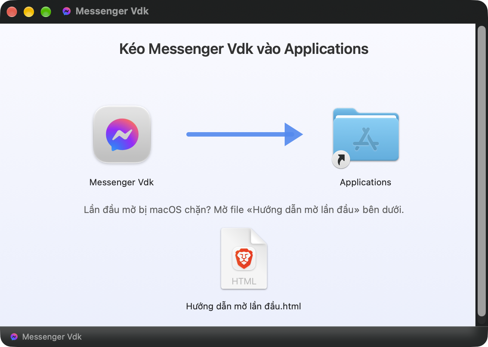

# Messenger Vdk

App Messenger gọn nhẹ cho macOS (chip Apple), viết bằng Swift + WKWebView. Chỉ **~1,2 MB** (bản Electron gốc ~241 MB).

> ⚠️ App **không chính thức**, không liên quan tới Meta. App chỉ mở trang **messenger.com** chính thức trong một cửa sổ riêng – đăng nhập, tin nhắn, cuộc gọi đi thẳng tới máy chủ Meta như khi dùng trình duyệt. App **không gửi dữ liệu đi đâu khác**, không thu thập thông tin người dùng.

## Tính năng
- **Thông báo tin nhắn** khi bạn ở app khác (cả tin nhóm). Dock chỉ nảy khi có cuộc gọi.
- **Bảng nổi cuộc gọi đến**: phân biệt gọi thoại / video / gọi nhóm (kèm tên nhóm), bấm Từ chối / Chấp nhận ngay trên bảng. Gác máy là tắt chuông.
- **Cuộc gọi**: chia sẻ màn hình, tự thu nhỏ thành cửa sổ nổi (PiP) khi chuyển app, ⇧⌘P.
- **Tải ảnh / file**: hỏi lưu vào đâu (hoặc lưu thẳng một thư mục), giữ độ phân giải gốc.
- **Phím tắt**: ⌘N tin nhắn mới · ⌘1–9 mở đoạn chat · ⌘F / ⇧⌘F tìm · ⌘S ẩn/hiện thông tin cuộc trò chuyện · ⇧⌘S ẩn/hiện thanh bên · ⌘/ bảng phím tắt.
- **Cài đặt (⌘,)**: thông báo, cuộc gọi, tải file, mở cùng máy, nhật ký gỡ lỗi.
- **Cập nhật trong app**: Cài đặt → Chung → *Kiểm tra cập nhật* – bản mới được kiểm chữ ký số (Ed25519) rồi tự cài. App không tự hỏi, chỉ kết nối GitHub khi bạn bấm.
- **Đăng xuất và xoá dữ liệu** (Cài đặt → Chung) cho máy dùng chung.
- Giữ đăng nhập, chỉ chạy 1 bản, giao diện tiếng Việt.

## Cài đặt
Yêu cầu: macOS 14 trở lên, chip Apple (M1/M2/M3…).

1. Tải file **`.dmg`** mới nhất ở mục **[Releases](../../releases/latest)**.
2. Bấm đúp file DMG → kéo **Messenger Vdk** vào **Applications**.

   

3. Mở lần đầu: app chưa được Apple công chứng nên macOS sẽ chặn → **Cài đặt hệ thống → Quyền riêng tư & Bảo mật → Bảo mật → Vẫn mở**.

👉 **Hướng dẫn chi tiết từng trường hợp (có ảnh): [HUONG-DAN-CAI.md](HUONG-DAN-CAI.md)** – file này cũng có sẵn trong DMG («Hướng dẫn mở lần đầu»).

Bộ gõ tiếng Việt: bộ gõ Apple chạy ngay. VietTelex: thêm app (bundle id `com.vduck.messenger`) vào bảng cơ chế gõ → **Gõ trực tiếp**.

## Tự build
```bash
bash build.sh
```
Ra `Messenger Vdk.app` trong `$TMPDIR/vduck-messenger-build`. Cần Xcode Command Line Tools. Ký app: đặt mã chứng chỉ vào biến `KY_APP` hoặc file `.ky-app`; không có thì ký tạm (ad-hoc).

Mã nguồn: `Ma nguon/main.swift` (toàn bộ app, chú thích tiếng Việt).

## Ghi công
Ý tưởng từ **MessengerApp** của Stefan – [stefanminch/messenger-mac](https://github.com/stefanminch/messenger-mac) (MIT). Bản này viết lại từ đầu bằng Swift.

Giấy phép: [CC BY-NC 4.0](LICENSE) – được dùng, chia sẻ, sửa lại nếu ghi nguồn, **không dùng vào mục đích thương mại**. (Bản 0.6.0 và 0.6.1 phát hành trước đó theo MIT.)

© 2026 by Vduck
